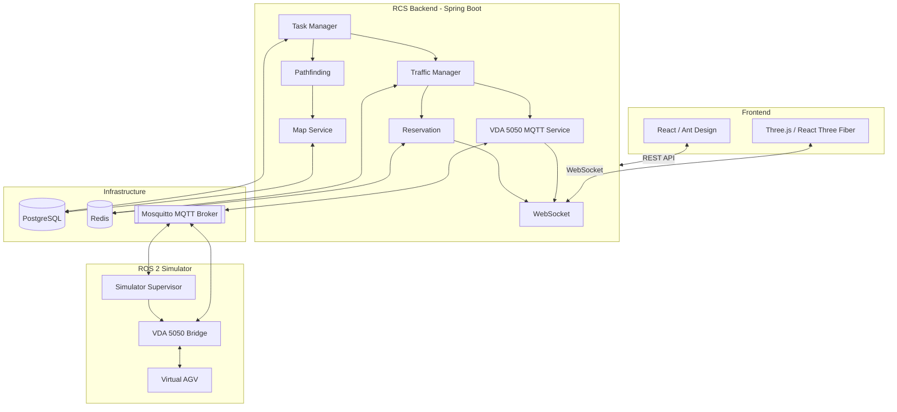

# AGV-Lab — AGV 多車調度學習專案

**AGV-Lab** 是一個以 AGV（無人搬運車）調度為主題的個人學習與實作專案。

本專案使用 Java Spring Boot 開發後端調度系統，搭配 React 與 Three.js 建立 3D 倉儲場景，並透過 ROS 2 模擬 AGV 的移動與狀態回報。

希望透過這個專案，實際了解 AGV 系統中地圖管理、路徑規劃、多車任務派發、交通管制，以及車輛通訊等基本概念，並嘗試將這些功能整合成一個可以操作與觀察的模擬環境。

### 專案主要功能
- **地圖管理：** 建立與管理倉儲地圖，支援路徑節點、道路及場景物件的編輯。
- **路徑規劃：** 使用 A* 等演算法，根據地圖拓撲尋找可行路徑。
- **任務管理：** 建立搬運任務，支援指定 AGV 或由系統選擇可用車輛。
- **交通管制：** 透過 Reservation 管理車輛行經的節點，減少多台 AGV 同時進入相同路段的情況。
- **車輛模擬：** 使用 ROS 2 建立虛擬 AGV，模擬移動、轉向及速度變化。
- **即時監控：** 透過 WebSocket 將車輛狀態同步至前端 3D 場景。

---

## 2. Demo / Screenshots（畫面展示）


https://github.com/user-attachments/assets/c2291fd4-b2c5-4cb7-b39a-9f7fb1a64d9f


---

## 3. Getting Started（快速安裝與啟動）

### 環境需求
使用Docker包裝專案, 只需要：
- [Git](https://git-scm.com/)
- [Docker Desktop](https://www.docker.com/products/docker-desktop/)（需包含 Docker Compose v2）

### 啟動方式

#### 1. 取得專案
```bash
git clone https://github.com/qythim/AGV-Lab.git
cd AGV-Lab
```

#### 2. 建置並啟動服務
```bash
docker compose up -d --build
```

專案目前使用 Docker Compose 管理 6 個服務：
- PostgreSQL
- Redis
- Mosquitto MQTT
- Spring Boot RCS Backend
- React Web Frontend
- ROS 2 Simulator

#### 3. 確認服務狀態
```bash
docker compose ps
```

確認相關服務已正常啟動後，開啟瀏覽器：
- **Web 管理與監控介面：** [http://localhost:5173](http://localhost:5173)

### 初次使用
1. 進入 Web 介面，建立 AGV 車輛資料。
2. 將 AGV 放置於地圖上的起始節點。
3. 進入 3D 場景，選擇取貨點與卸貨點。
4. 建立搬運任務，觀察系統派發任務、規劃路徑及車輛移動的過程。

> 專案內建 `WAREHOUSE_120` 範例地圖，首次初始化資料庫時會由系統匯入。

### 服務連接埠

| 服務 | 說明 | 位址 |
| :--- | :--- | :--- |
| **Web Frontend** | 3D 場景與管理介面 | `localhost:5173` |
| **RCS Backend** | REST API / WebSocket | `localhost:8080` |
| **MQTT Broker** | 車輛訊息通訊 | `localhost:1883` |
| **PostgreSQL** | 資料庫 | `localhost:5432` |
| **Redis** | 即時資料與交通管制 | `localhost:6379` |
| **ROS 2 Simulator** | AGV 模擬服務 | 容器內部網路 |

### 常用指令
```bash
# 查看服務狀態
docker compose ps

# 查看後端與 ROS 2 日誌
docker compose logs -f java21 ros2

# 停止服務
docker compose down

# 重新建置前端
docker compose up -d --build node24

# 重新建置後端
docker compose up -d --build java21

# 清除容器及持久化資料
docker compose down -v --remove-orphans
```

---

## 4. System Architecture（系統架構與運作流程）

### 整體架構



### 核心子系統

1. **地圖管理（Map Service）**
   - 管理地圖中的節點、道路及 3D 場景物件。
   - 地圖資料儲存於 PostgreSQL，並使用 GZIP 壓縮。
   - 啟用地圖後，後端會建立供路徑規劃使用的 `MapGraph`。

2. **路徑規劃（Pathfinding）**
   - 以地圖節點與道路關係建立圖形結構。
   - 目前實作 A*、Dijkstra 與 BFS 等搜尋演算法。
   - A* 使用節點間的歐幾里得距離作為啟發函數。

3. **任務管理（Task Manager）**
   - 建立 AGV 搬運任務，支援指定車輛與自動選擇可用車輛。
   - 自動指派時，會參考車輛與任務起點的距離，以及是否存在可行路徑。
   - 搬運任務分為取貨（`PICKUP`）與卸貨（`DELIVERY`）兩個階段。

4. **交通管制與預約管理（Traffic Manager & Reservation）**
   - AGV 不會一次預約整條路徑，而是依照目前位置，逐步預約前方一定範圍內的節點。
   - 車輛通過節點後，系統會釋放已不需要的預約。
   - 使用 Redis 管理節點預約與等待佇列。
   - 當節點被釋放時，系統會通知正在等待的車輛，讓其重新嘗試取得預約。

5. **車輛通訊與 ROS 2 模擬**
   - 後端透過 MQTT 與 ROS 2 模擬器交換車輛訂單及狀態。
   - 通訊部分參考 VDA 5050 v2.0 的 Topic 與訊息格式，目前實作 `order`、`state`、`connection` 和 `instantActions` 等功能。
   - ROS 2 端包含車輛管理節點、通訊橋接節點與 Virtual AGV。
   - Virtual AGV 可接收移動指令，並根據速度、加速度與轉向設定更新自身位置。

6. **前端即時狀態同步（WebSocket）**
   - 前端透過 WebSocket 接收 AGV 車輛狀態及節點預約資訊。
   - 初次連線時取得完整狀態，後續接收有變動的資料。
   - 使用 React Three Fiber 更新 3D 場景中的車輛位置與方向。

---

## 5. Technology Stack（技術棧）

| 領域 | 技術 | 用途 |
| :--- | :--- | :--- |
| **Frontend** | React 19、TypeScript 6、Vite 8 | Web 前端開發 |
| **3D Rendering** | Three.js、React Three Fiber、Drei | 3D 倉儲場景與地圖編輯 |
| **UI** | Ant Design 6 | 管理介面 |
| **Backend** | Java 21、Spring Boot 4 | RCS 後端服務 |
| **Data Access** | Spring Data JPA、Spring JDBC、Flyway | 資料存取與資料庫版本管理 |
| **Communication** | MQTT、WebSocket | 後端、模擬器與前端之間的資料交換 |
| **Database** | PostgreSQL 18 | 地圖、車輛及任務資料 |
| **Cache** | Redis 8 | 節點預約與等待佇列 |
| **Robot Simulation** | ROS 2 Jazzy、Python、NumPy | AGV 移動與狀態模擬 |
| **Message Broker** | Eclipse Mosquitto 2.0 | MQTT 訊息代理 |
| **Deployment** | Docker、Docker Compose、Nginx | 容器化建置與服務部署 |

---

## 6. Project Structure（專案目錄結構）

```text
AGV-Lab/
├── compose.yaml
├── README.md
├── mosquitto/
│   └── config/
│       └── mosquitto.conf
│
├── rcs/                              # Spring Boot RCS Backend
│   ├── Dockerfile
│   ├── pom.xml
│   ├── docs/
│   └── src/main/
│       ├── java/com/agvlab/rcs/
│       │   ├── agv/                  # AGV 車輛管理與通訊
│       │   ├── map/                  # 地圖管理
│       │   ├── pathfinding/          # 路徑規劃
│       │   ├── seed/                 # 預設地圖資料
│       │   ├── task/                 # 任務管理
│       │   ├── traffic/
│       │   │   ├── manager/          # 交通管制
│       │   │   └── reservation/      # 節點預約管理
│       │   └── websocket/            # WebSocket 狀態同步
│       └── resources/
│           ├── db/migration/         # Flyway Migration
│           └── seed/
│               └── warehouse_120.json
│
├── amr-web/                          # React 3D Frontend
│   ├── Dockerfile
│   ├── nginx.conf
│   └── src/
│       ├── features/
│       │   ├── map-management/
│       │   ├── map-editor/
│       │   └── task/
│       ├── lib/
│       └── shared/
│
└── ros2/                             # ROS 2 AGV Simulator
    ├── docker/
    │   └── Dockerfile
    └── ros2_ws/src/agv_simulator/
        ├── launch/
        └── agv_simulator/
            ├── sim_supervisor.py
            ├── vda5050_bridge.py
            └── virtual_agv.py
```

---

## Project Notes

- AGV-Lab 是個人學習與實作專案，主要目標是理解 AGV 調度系統的基本架構，並透過模擬環境驗證各個模組之間的互動。
- 目前的模擬環境並非實際工業 AGV，也尚未涵蓋真實設備的定位、安全控制、感測器整合及現場部署等完整需求。
- 專案仍會持續調整與改善。
