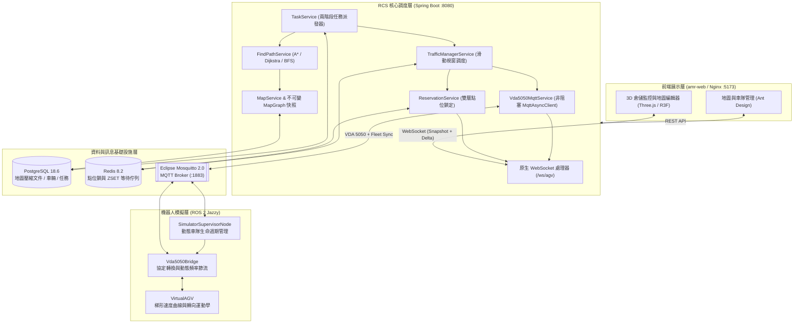

# AGV-Lab — 工業級多車調度系統與 3D 智慧倉儲模擬平台

**AGV-Lab** 是一套全端容器化的工業級 **無人搬運車控制系統（RCS, Robot Control System）**、**ROS 2 VDA 5050 多車運動學模擬器** 與 **Web 3D 即時監控暨地圖編輯平台**。

本專案完整實作了智慧倉儲從「3D 拓撲建模 → 兩階段搬運任務自動派發 → A* 路徑規劃 → 滑動視窗交通管制與死鎖預防 → VDA 5050 標準通訊 → 60fps 3D 即時視覺化」的端到端閉環，並支援透過 **Docker Compose 單一指令一鍵建置與啟動全系統**。

### 核心亮點
- **標準工業通訊協定（VDA 5050）：** 透過 MQTT 實作 `order`、`state`、`connection`（含 LWT 遺囑）與 `instantActions` 四大標準主題，解耦調度核心與底層車輛。
- **純事件驅動交通管制（Traffic & Reservation）：** 結合滑動視窗點位鎖定（Sliding-Window Locking）與 Redis ZSET FIFO 等待佇列，點位釋放時 `0ms` 即時喚醒排隊車輛，全程零輪詢（Zero-Polling）。
- **智慧任務派發（Task Manager）：** 支援指定車輛與自動配對最近可用車輛（Auto-Assign），自動串接「前往取貨點（`PICKUP`）→ 前往卸貨點（`DELIVERY`）」兩階段行程。
- **真實物理運動學模擬（ROS 2 Jazzy）：** 支援車隊動態生成／銷毀，內建梯形／三角形加減速曲線（Velocity Profile）、轉角預減速與原地轉向控制。
- **高效能 3D 視覺化與編輯器（React Three Fiber）：** 採用 WebSocket `FULL_SNAPSHOT + Delta Update + RESYNC` 同步機制與客戶端 60fps 線性內插，並內建 3D 地圖拓撲編輯器。

---

## 2. Demo / Screenshots（畫面展示）

> 💡 可將系統執行畫面截圖或錄影檔放置於 `docs/screenshots/` 目錄並替換下方路徑：

| 3D 智慧倉儲即時監控與任務派發 | 3D 拓撲地圖視覺化編輯器 |
| :---: | :---: |
|  |  |
| *120 節點倉儲即時多車調度、點位鎖定高亮與即時車速顯示* | *支援路徑點、單／雙向路線、貨架、充電站與工作站 3D 建模* |

| 地圖管理與版本控制 | 車隊登錄與點位放置 |
| :---: | :---: |
|  |  |
| *GZIP 壓縮版本化地圖管理、JSON 匯入與一鍵啟用* | *車輛登錄與初始點位放置（即時觸發 ROS 2 動態生成實體）* |

---

## 3. Getting Started（快速安裝與啟動）

### 環境需求
本機**無須安裝** Java、Node.js、ROS 2、PostgreSQL、Redis 或 Mosquitto，僅需安裝：
- [Git](https://git-scm.com/)
- [Docker Desktop](https://www.docker.com/products/docker-desktop/)（需包含 Docker Compose v2）

### 三步驟一鍵啟動

#### 1. 取得專案原始碼
```bash
git clone https://github.com/<your-username>/AGV-Lab.git
cd AGV-Lab
```

#### 2. 建置映像檔並啟動全系統（共 6 個容器）
```bash
docker compose up -d --build
```
> **提示：** 首次建置需下載基礎映像檔並編譯 Spring Boot JAR、前端靜態資源與 ROS 2 套件，約需 **2～4 分鐘**；後續啟動僅需執行 `docker compose up -d`，數秒內即可就緒。

#### 3. 確認服務健康狀態並開啟系統
```bash
docker compose ps
```
當 `AL-postgres`、`AL-redis`、`AL-mqtt`、`AL-java21` 顯示為 `Up (healthy)`，且 `AL-node24`、`AL-ros2` 為 `Up` 時，即可開啟瀏覽器前往：
- **Web 3D 管理與監控介面：** [http://localhost:5173](http://localhost:5173)

### 首次啟動自動化機制與快速體驗
1. **自動建表與預設地圖匯入：** 容器啟動時，Flyway 會自動建立所有資料表；若資料庫為空，`DefaultMapSeeder` 會自動匯入並啟用內建的 120 節點智慧倉儲地圖（`WAREHOUSE_120`）。
2. **新增並放置 AGV：** 進入網頁後切換至「**AGV 管理**」，新增 1～3 台車輛（如 `AGV_01`、`AGV_02`），並將車輛放置於 `WAREHOUSE_120` 的任意節點上（ROS 2 模擬器將立即動態生成對應虛擬車輛）。
3. **派發搬運任務：** 點擊「**開啟 3D**」進入 3D 倉儲視角，於右側任務面板點選地圖上的「取貨點」與「卸貨點」（可選擇自動指派車輛），即可觀察多車路徑規劃、點位鎖定讓行與即時車速變化。

### 服務連接埠一覽

| 服務名稱 | 容器名稱 | 說明 | 對外位址 / 連接埠 |
| :--- | :--- | :--- | :--- |
| **Frontend Web UI** | `AL-node24` | 3D 倉儲監控、地圖編輯與車隊管理介面 | `http://localhost:5173` |
| **RCS Backend** | `AL-java21` | RESTful API 與原生 WebSocket（`/ws/agv`） | `http://localhost:8080` |
| **ROS 2 Simulator** | `AL-ros2` | VDA 5050 多車動態監督器與運動學模擬節點 | 容器內部網路 |
| **MQTT Broker** | `AL-mqtt` | Eclipse Mosquitto 訊息代理伺服器 | `127.0.0.1:1883` |
| **PostgreSQL** | `AL-postgres` | 核心關聯式資料庫（`rcs_db`） | `127.0.0.1:5432` |
| **Redis** | `AL-redis` | 點位分散式鎖與交通排隊佇列（AOF 持久化） | `127.0.0.1:6379` |

### 常用維運指令
```bash
# 即時查看 RCS 後端與 ROS 2 模擬器日誌
docker compose logs -f java21 ros2

# 停止所有容器（保留資料庫與地圖資料）
docker compose down

# 修改程式碼後重新建置指定服務（例如僅更新前端或後端）
docker compose up -d --build node24
docker compose up -d --build java21

# 完整重置系統至初始空白狀態（警告：將清除所有資料庫與快取卷）
docker compose down -v --remove-orphans
```

---

## 4. System Architecture（系統架構與運作流程）

### 整體架構拓撲



### 核心子系統與資料流設計

1. **版本化壓縮地圖與不可變記憶體圖譜（`MapService` & `MapGraph`）**
   - 地圖包含節點、有向邊與 3D 場景物件，以 **GZIP 二進位壓縮 + SHA-256 雜湊校驗** 採用附加式版本控制（Append-only Versioning）儲存於 PostgreSQL，並搭配磁碟快取按需重建。
   - 啟用中的地圖會解析為 Java `record` 不可變快照（`MapGraph`），讓多執行緒路徑搜尋與訂單座標轉換皆能以 $O(1)$ 無鎖（Lock-free）讀取。

2. **多演算法路徑規劃引擎（`FindPathService`）**
   - 針對有向圖拓撲實作 **A\***（以歐幾里得直線距離作為啟發函數）、**Dijkstra** 與 **BFS** 三種演算法，供任務派發評估最短可行路徑。

3. **非阻塞兩階段任務調度（`TaskService`）**
   - 建立任務時於資料庫交易提交後（`afterCommit`）交由單執行緒派發器 `rcs-task-dispatcher` 依序配對，既避免阻塞 HTTP 請求，也天然防止多執行緒重複指派同一台車輛。
   - 支援 **Auto-Assign**（依直線距離由近至遠篩選具合法 A* 路徑之 `IDLE` 車輛），並自動拆解為 **取貨段（`:PICKUP`）** 與 **卸貨段（`:DELIVERY`）** 寫入 `rcs_task_detail` 追蹤完整歷程。

4. **滑動視窗交通管制與零輪詢喚醒（`TrafficManagerService` & `ReservationService`）**
   - 車輛並非一次鎖死整條路徑，而是依當前位置動態申請前方 `N` 個節點（預設滑動視窗 `windowSize = 4`），並隨車輛推進自動釋放已駛離節點。
   - 點位鎖定採用 **JVM 記憶體鎖（`PointLockMemoryManager`）+ Redis 原子鎖** 雙層保護；若前方節點遭佔用，申請失敗會原子回滾並將車輛依時間戳寫入 Redis ZSET 佇列（`TrafficWait:<pointCode>`），待前車釋放節點觸發 `PointReleasedEvent` 時立即依 FIFO 順序喚醒並下發新視窗訂單。

5. **VDA 5050 非阻塞通訊與 ROS 2 多車運動學模擬**
   - **RCS 端：** 採用非阻塞 `MqttAsyncClient` 處理高併發 QoS 1 訊息，避免回呼執行緒死鎖；除了標準 VDA 5050 主題外，另透過 `sim/fleet/snapshot`（Retained）與 `sim/fleet/control` 與模擬器即時同步車輛之生成（`SPAWN`）、移位（`PLACE`）與銷毀（`DESTROY`）。
   - **ROS 2 端：** `VirtualAGV` 以 20Hz 計算梯形／三角形加減速曲線，遇轉角（`> 0.2 rad`）自動減速至零執行原地轉向；`Vda5050Bridge` 則實施動態狀態節流（移動時 20Hz、靜止時 1Hz、節點推進或狀態變更時 `0ms` 立即推送），兼顧 3D 順暢度與閒置頻寬效率。

6. **WebSocket 即時狀態同步策略（`FULL_SNAPSHOT` + `Delta` + `60fps Interpolation`）**
   - 前端連線建立或重連時立即接收一次 `FULL_SNAPSHOT`（含全車隊狀態與所有鎖定點位）；運行期間僅推送變動車輛之 `AGV_POSE`（零 Redis 讀取開銷）與點位變更之 `AGV_LOCKS`。
   - 前端透過 React Three Fiber `useFrame` 進行座標與角度平滑內插，並以 DOM Ref 直接更新車頂即時速度標籤（零 React 元件重繪）。

---

## 5. Technology Stack（技術棧）

| 領域 | 核心技術與版本 | 用途說明 |
| :--- | :--- | :--- |
| **前端介面 (`amr-web`)** | React `19.2`、TypeScript `6.0`、Vite `8.3` | 模組化單頁應用程式架構與高速打包 |
| **3D 渲染與 UI 套件** | Three.js `0.186`、`@react-three/fiber`、`@react-three/drei`、Ant Design `6.6` | 3D 倉儲場景渲染、地圖編輯互動與後台管理介面 |
| **前端靜態伺服器** | Nginx（`nginx:alpine`） | 生產環境輕量化靜態資源託管與 SPA 路由支援 |
| **後端核心 (`rcs`)** | Java `21`（LTS）、Spring Boot `4.1.1` | RCS 核心業務邏輯、事件驅動調度與 REST API |
| **資料存取與遷移** | Spring Data JPA、Spring JDBC、Flyway | ORM 實體映射、`bytea` 地圖壓縮存取與自動化資料庫版本遷移 |
| **即時通訊協定** | Eclipse Paho MQTT `1.2.5`、Spring Native WebSocket | VDA 5050 車輛雙向通訊與前端低延遲狀態廣播 |
| **資料庫與快取** | PostgreSQL `18.6`、Redis `8.2`、Eclipse Mosquitto `2.0` | 持久化儲存、分散式點位鎖／ZSET 佇列、MQTT Broker |
| **機器人模擬 (`ros2`)** | ROS 2 `Jazzy Jalisco`、Python 3、NumPy、`colcon` | 多車動態生成監督器、運動學模擬與 VDA 5050 橋接節點 |
| **容器化部署** | Docker Multi-stage Build、Docker Compose | 前後端與模擬器多階段封裝、健康檢查與服務啟動編排 |

---

## 6. Project Structure（專案目錄結構）

```text
AGV-Lab/
├── compose.yaml                          # 全系統 6 容器一鍵編排與健康檢查設定
├── README.md                             # 專案說明文件
├── mosquitto/
│   └── config/mosquitto.conf             # Mosquitto MQTT Broker 設定檔
│
├── rcs/                                  # Spring Boot RCS 核心後端 (Java 21)
│   ├── Dockerfile                        # 多階段建置 (JDK 21 編譯 -> JRE 21 執行)
│   ├── pom.xml                           # Maven 相依套件與建置設定
│   ├── docs/                             # 架構決策紀錄 (ADR) 與設計文件
│   └── src/main/
│       ├── java/com/agvlab/rcs/
│       │   ├── agv/                      # 車輛管理、事件與 VDA 5050 MQTT 非阻塞通訊
│       │   ├── map/                      # 地圖驗證、GZIP 壓縮儲存與不可變 MapGraph
│       │   ├── pathfinding/              # A*、Dijkstra、BFS 路徑規劃服務
│       │   ├── seed/                     # 首次啟動預設地圖自動匯入器 (DefaultMapSeeder)
│       │   ├── task/                     # 兩階段搬運任務管理與單執行緒非阻塞派發器
│       │   ├── traffic/
│       │   │   ├── manager/              # 滑動視窗交通調度與 FIFO 佇列喚醒 (TrafficManager)
│       │   │   └── reservation/          # JVM + Redis 雙層點位鎖定服務 (ReservationService)
│       │   └── websocket/                # 原生 WebSocket 連線管理與快照/差量廣播
│       └── resources/
│           ├── db/migration/             # Flyway SQL 資料表遷移腳本 (V1 ~ V4)
│           └── seed/warehouse_120.json   # 內建 120 節點智慧倉儲預設範例地圖
│
├── amr-web/                              # Web 3D 監控與管理前端 (React + TypeScript)
│   ├── Dockerfile                        # 多階段建置 (Node 24 打包 -> Nginx Alpine 託管)
│   ├── nginx.conf                        # SPA 靜態資源伺服器設定 (:5173)
│   └── src/
│       ├── features/
│       │   ├── map-management/           # 地圖清單、JSON 匯入、啟用與 AGV 車隊管理
│       │   ├── map-editor/               # 3D 倉儲場景、物件模型、即時內插與視覺化編輯器
│       │   └── task/                     # 3D 點選建立搬運任務與任務狀態側邊欄
│       ├── lib/agvWebSocket.ts           # WebSocket 自動重連與訊息解析客戶端
│       └── shared/                       # 跨模組共用 Hooks 與工具
│
└── ros2/                                 # ROS 2 VDA 5050 多車模擬器 (Jazzy)
    ├── docker/Dockerfile                 # 建置期預編譯 colcon 並自動啟動模擬器
    └── ros2_ws/src/agv_simulator/
        ├── launch/agv_simulation.launch.py # 多車模擬器啟動腳本與運動學參數宣告
        └── agv_simulator/
            ├── sim_supervisor.py         # 監聽車隊同步事件並動態 SPAWN / PLACE / DESTROY 車輛
            ├── vda5050_bridge.py         # VDA 5050 四大主題橋接與 20Hz/1Hz 動態狀態節流
            └── virtual_agv.py            # 20Hz 梯形/三角形速度曲線與原地轉向物理運動模擬
```
